# Lab 1：CUDA SGEMM 報告

- 學號：`<student_id>`
- 姓名：`<name>`

---

## Part 0：Know your GPU

### Q1

| 項目 | 數值 |
|---|---|
| GPU | NVIDIA GeForce RTX 5090 |
| Compute capability | 12.0（`sm_120`） |
| SM 數 | 170 |
| Peak FP32 | 2 × 21,760 cores × 2.407 GHz = **104,752.6 GFLOP/s** |
| Peak DRAM bandwidth | 28 Gbps × 512 bit ÷ 8 = **1,792 GB/s** |

`./sgemm` 印出的 peak（104,753 GFLOP/s、1,792 GB/s）跟公式算出來的一致。公式裡的 2 是因為一個 FMA（`a × b + c`）算 2 個 FLOP。

### Q2

**Ridge point** = 104,752.6 / 1,792 ≈ **58.46 FLOP/byte**

**4096³ 的 arithmetic intensity**（A、B 各讀一次、C 寫一次，每個 float 4 bytes）

- FLOPs = 2MNK = 2n³
- Bytes = 4(MK + KN + MN) = 12n²
- AI = 2n³ / 12n² = n / 6 = 4096 / 6 ≈ **682.67 FLOP/byte**

682.67 > 58.46，所以 4096³ 的 SGEMM 在這張 GPU 上是 **compute-bound**。

---

## Part 1：The naive kernel and the profiler

### Q1

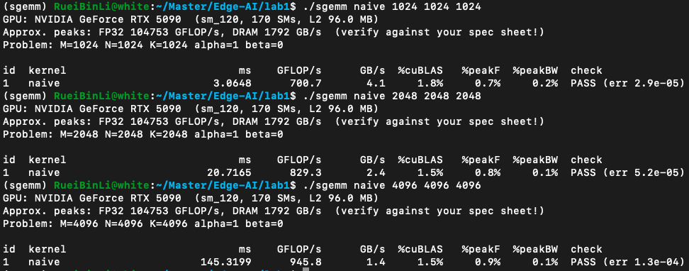

| Size | naive (ms) | naive GFLOP/s | naive %cuBLAS | cuBLAS (ms) |
|---|---|---|---|---|
| 1024³ | 3.0648 | 700.7 | 1.8% | 0.0553 |
| 2048³ | 20.7165 | 829.3 | 1.5% | 0.3113 |
| 4096³ | 145.3199 | 945.8 | 1.5% | 2.1453 |

### Q2

ncu（naive 2048³）：

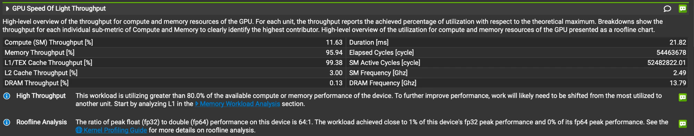

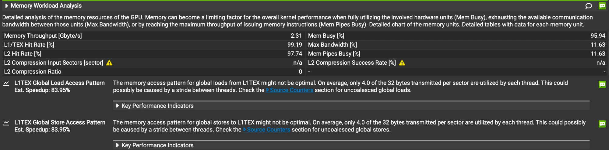

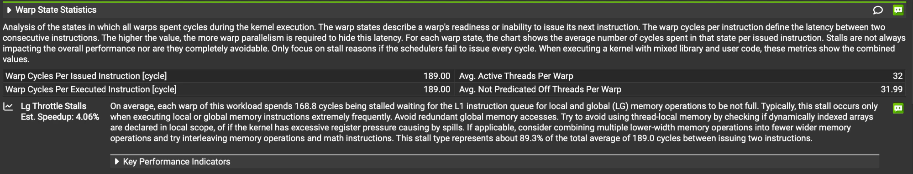

naive 是被**記憶體**限制住。Compute (SM) Throughput 只有 11.63%，Memory Throughput 有 95.94%，其中 L1/TEX 是 99.38%。ncu 顯示每個 32 B 的 sector 只用到 4 bytes，代表讀取是 uncoalesced；Warp State 裡 LG Throttle 每個 warp 佔了 168.8 cycles（89.3%），warp 大部分時間都在等 load 指令排進 L1 的佇列。

naive 在 4096³ 只達到 peak FP32 的 **0.90%**（945.8 / 104,753）。

---

## Part 2：Coalescing

### Q1

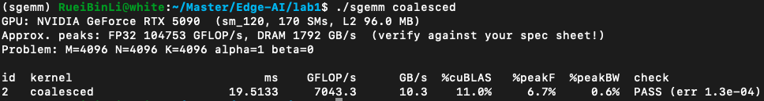

| Size | naive (ms) | coalesced (ms) | speedup |
|---|---|---|---|
| 4096³ | 145.3199 | 19.5133 | 7.45× |

### Q2

| ncu（2048³，global load） | naive | coalesced |
|---|---|---|
| sectors / request | **16.5** | **2.5** |

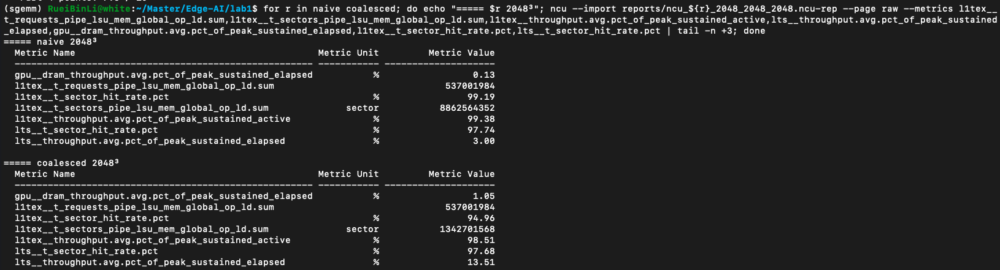

sectors / request = `l1tex__t_sectors_pipe_lsu_mem_global_op_ld.sum` ÷ `l1tex__t_requests_pipe_lsu_mem_global_op_ld.sum`：naive 8,862,564,352 / 537,001,984 = 16.5；coalesced 1,342,701,568 / 537,001,984 = 2.5。

naive 裡 `row` 對應 `threadIdx.x`，一個 warp 讀 A 時相鄰 thread 差 K 個 float，32 個 thread 落在 32 個不同的 sector；讀 B 時大家讀同一個值，只要 1 個 sector，平均 (32 + 1) / 2 = 16.5。coalesced 改成 `col` 對應 `threadIdx.x`，讀 A 變成 broadcast（1 個 sector），讀 B 是 32 個連續的 float（4 個 sector），平均 (1 + 4) / 2 = 2.5。FLOPs 和 load 的次數都一樣，但每次 load 要處理的 sector 少了約 6.6 倍，所以快了約 7.5 倍。

### Q3

| ncu（2048³） | naive | coalesced |
|---|---|---|
| L1/TEX Throughput | 99.38% | 98.51% |
| L2 Throughput | 3.00% | 13.51% |
| DRAM Throughput | 0.13% | 1.05% |
| L1 Hit Rate | 99.19% | 94.96% |
| L2 Hit Rate | 97.74% | 97.68% |

（數據見 Q2 的截圖。）

現在最忙的還是 **L1**（98.51%）。A、B 的重複讀取主要由 **L1** 滿足（hit rate 94.96%），沒中的由 L2 滿足（hit rate 97.68%），DRAM 只有 1.05%。

---

## Part 3：Tiling with shared memory and registers

### Q1

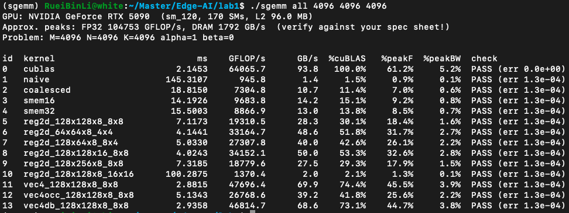

| 設定（4096³） | 時間 (ms) | regs / thread | smem / block | theoretical occ. | achieved occ. | 主要 warp stall | shared bank conflicts（load / store） |
|---|---|---|---|---|---|---|---|
| 128x128x8_8x8 | 7.12 | 96 | 8.19 KB | 33.33% | 33.30% | long_scoreboard | 268.4M / 117.4M |
| 64x64x8_4x4 | 4.14 | 40 | 4.10 KB | 100% | 96.43% | long_scoreboard | 5.7K / 234.9M |
| 128x64x8_8x4 | 5.03 | 64 | 6.14 KB | 66.67% | 66.46% | long_scoreboard | 26 / 234.9M |
| 128x128x16_8x8 | 4.02 | 112 | 16.38 KB | 33.33% | 33.29% | long_scoreboard | 269.2M / 257.7M |
| 128x256x8_8x8 | 7.32 | 96 | 12.29 KB | 33.33% | 33.36% | long_scoreboard | 268.4M / 60.3M |
| 128x128x8_16x16 | 100.29 | 255 | 8.19 KB | 16.67% | 14.72% | long_scoreboard | 404.2M / 117.5M |

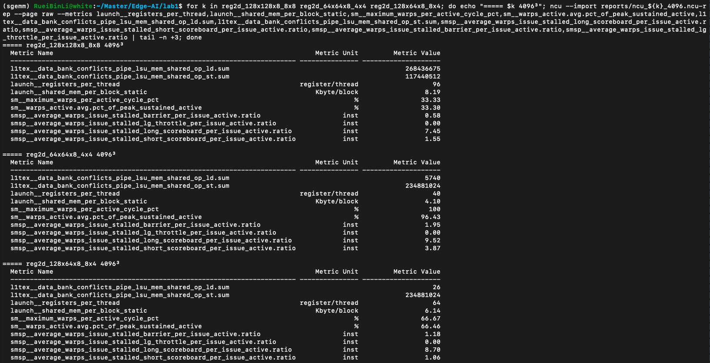

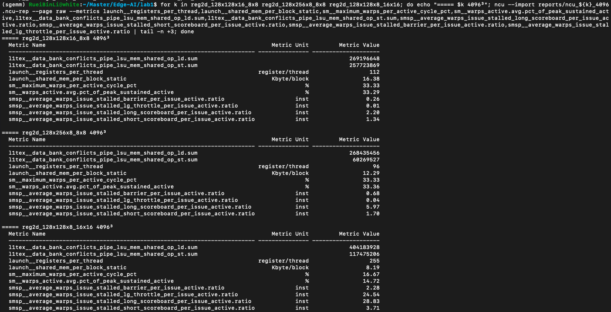

### Q2

| | shared load / FMA |
|---|---|
| 3a smem | 2 / 1 = **2** |
| 3b reg2d（TM = TN = 8） | (8 + 8) / 64 = **0.25** |

3a 每做 1 次 FMA 要從 shared memory 讀 2 個值；3b 每個 thread 一次讀 TM + TN = 16 個值到 register，可以做 TM × TN = 64 次 FMA，shared load 少了 8 倍，所以 3b 比 3a 快很多（smem16 14.19 ms → reg2d_128x128x8_8x8 7.12 ms）。

### Q3

**最快：reg2d_128x128x16_8x8（4.02 ms）**。

**明顯較慢：reg2d_128x128x8_16x16（100.29 ms）**。`acc[16][16]` 需要的 register 超過上限，用了 255 個 register 還 spill 了 332 B 到 local memory。ncu 顯示 local memory 寫了 10.2G 個 sector、讀了 1.66G 個 sector，SM Throughput 只有 6.4%；achieved occupancy 也只有 14.72%，stall 主要是 long_scoreboard（28.83）和 lg_throttle（24.54），都在等記憶體。

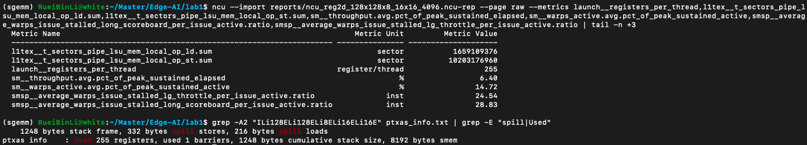

---

## Part 4：Your own optimizations

### Q1

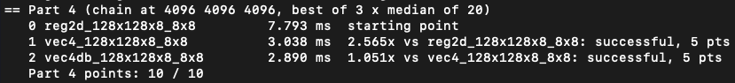

| 步驟 | kernel | 時間 (ms) | speedup |
|---|---|---|---|
| 0 | reg2d_128x128x8_8x8 | 7.793 | — |
| 1 | vec4_128x128x8_8x8 | 3.038 | 2.565× |
| 2 | vec4db_128x128x8_8x8 | 2.890 | 1.051× |

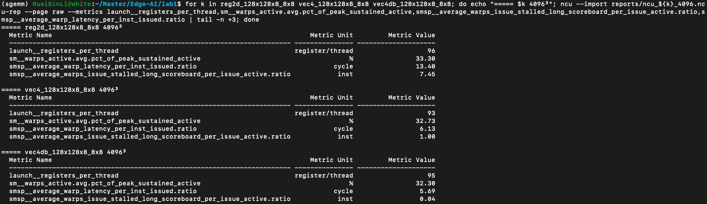

**優化 1：Vectorized global load（float4）**

- **做了什麼**：搬 A、B 的 tile 時，用 `float4` 一次讀 4 個連續的 float。
- **前後時間**：7.793 ms → 3.038 ms，**2.565×**。
- **為什麼有效**：

| | 搬運部分的指令（SASS） | long_scoreboard |
|---|---|---|
| reg2d_128x128x8_8x8 | `LDG → STS → LDG → STS`（迴圈沒展開，每個 load 都要等） | 7.45 |
| vec4_128x128x8_8x8 | `LDG.128, LDG.128 → STS…`（兩個 load 一起發出，只等一次） | 1.00 |

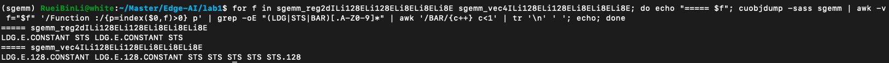

occupancy 沒變（都是 33%），差別在原本每個 tile 要排隊等 8 次 load，改成 float4 之後兩個 load 同時在路上，只要等一次，long_scoreboard 從 7.45 降到 1.00。

**優化 2：Double buffering**

- **做了什麼**：在計算目前的 tile 之前，先發出下一個 tile 的 global load 存到 register，算完再存進 shared memory。
- **前後時間**：3.038 ms → 2.890 ms，**1.051×**。
- **為什麼有效**：load 發出後到被用到之間隔了一整段 outer product（每個 thread 512 次 FMA），等待被計算蓋掉。long_scoreboard 從 1.00 降到 0.04，CPI 從 6.13 降到 5.69。多用的 8 個 register（95 個）沒有讓 occupancy 下降，也沒有 spill。
